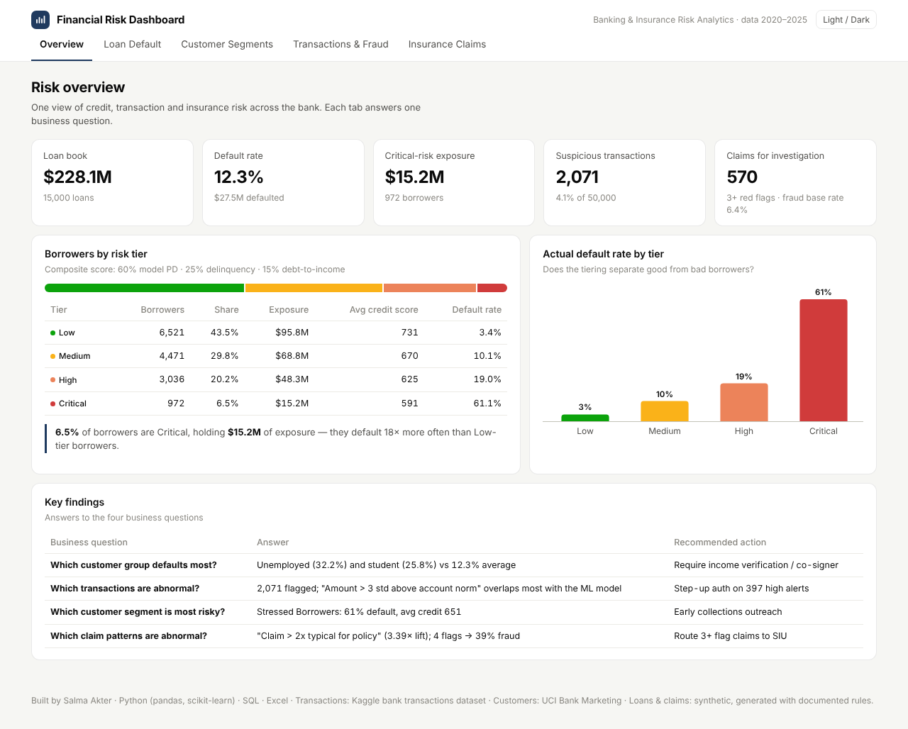
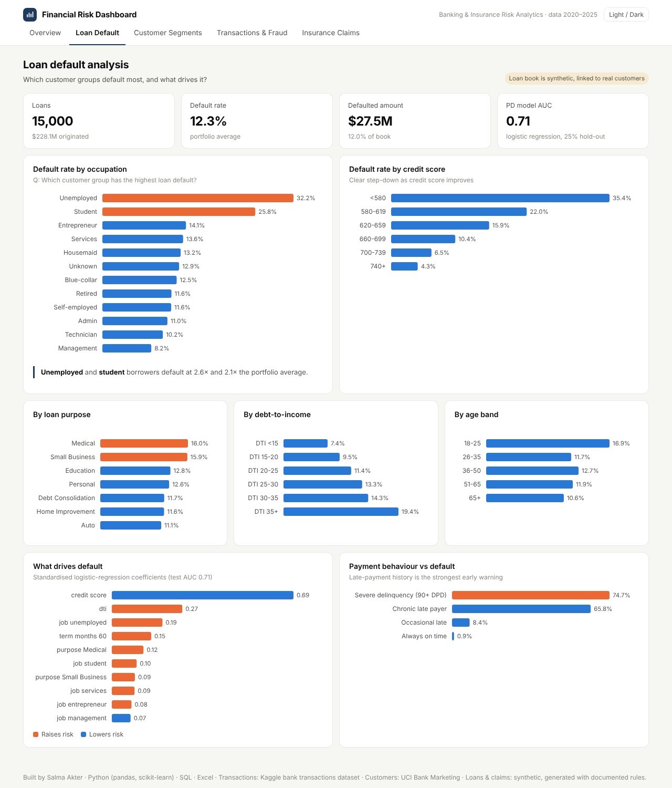
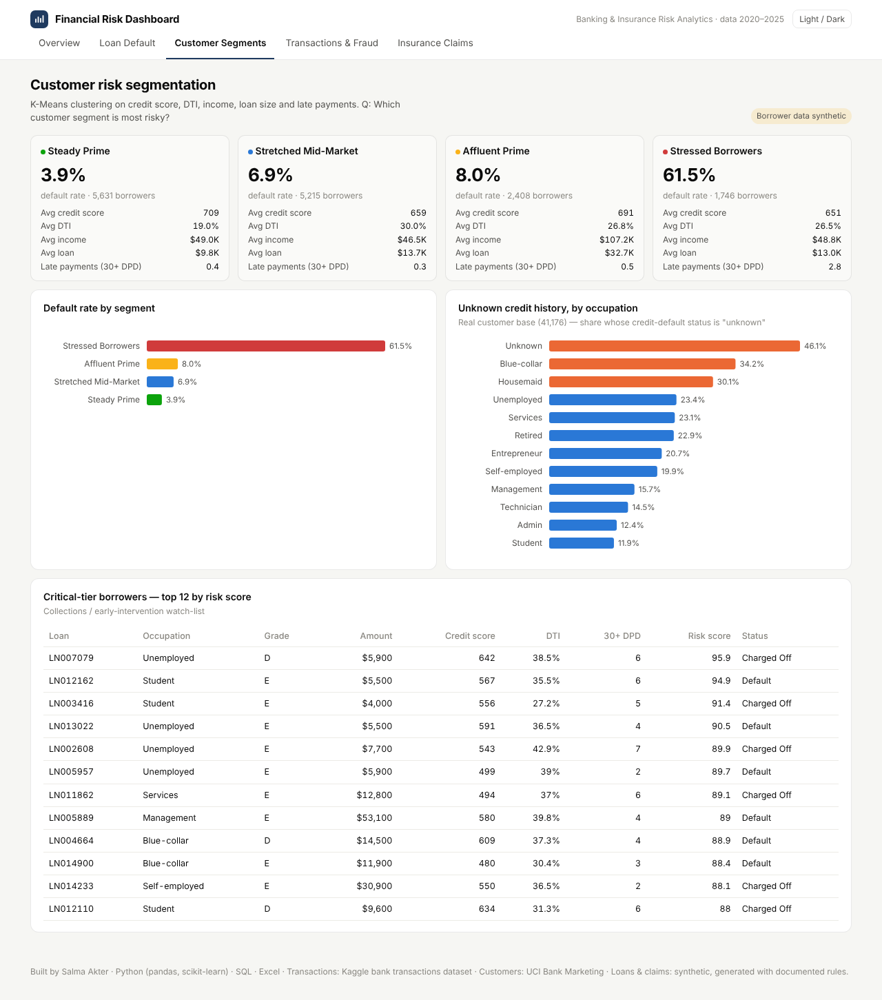
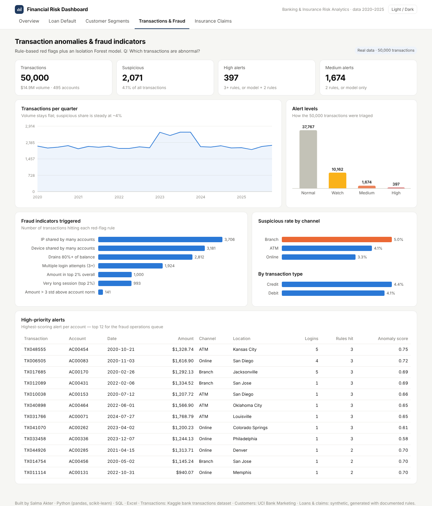
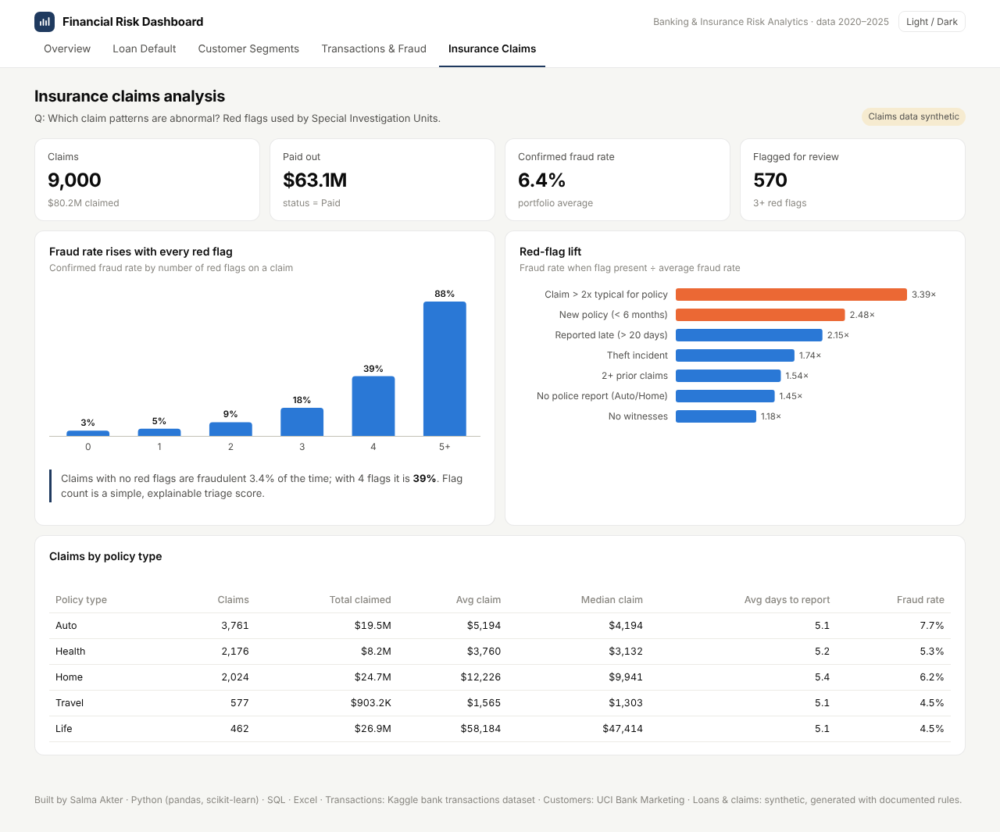

# Banking & Insurance Risk Analytics

**End-to-end financial risk project — loan default, customer risk segmentation, transaction anomaly detection and insurance claims fraud.**
Built for Data Analyst / Financial Data Analyst roles in banking and insurance.

**[Live Streamlit app →](https://banking-insurance-risk-analytics.streamlit.app)** · [Static dashboard](https://sakter2618-maker.github.io/banking-insurance-risk-analytics/) · [Risk Report](reports/Risk_Report.md) · [SQL queries](sql/02_business_queries.sql) · [Excel workbook](excel/Risk_Analytics_Workbook.xlsx)



---

## Business questions answered

| # | Question | Answer (short) |
|---|---|---|
| 1 | Which customer group has the highest loan default? | **Unemployed (32%)** and **students (26%)** vs a 12.3% average |
| 2 | Which transactions are abnormal? | **2,071 (4.1%)** flagged by 7 rules + Isolation Forest; 397 high-priority |
| 3 | Which customer segment is most risky? | **Stressed Borrowers** (K-Means) — 61% default; *Critical* risk tier holds $15.2M exposure |
| 4 | Which insurance claim patterns are abnormal? | Claims > 2× typical amount (3.4× fraud lift), new policies, late reporting; 4 red flags → 39% fraud |

Full findings and recommendations: **[reports/Risk_Report.md](reports/Risk_Report.md)**

## The seven analyses

| Analysis | Method | Where |
|---|---|---|
| Loan Default Analysis | Default rate by group + logistic-regression PD model (AUC 0.71) | Python, SQL Q1–Q4 |
| Customer Risk Segmentation | K-Means clustering (k = 4) on credit, DTI, income, loan size, late payments | Python |
| Transaction Anomaly Detection | 7 rule-based red flags + Isolation Forest | Python, SQL Q7 |
| Insurance Claims Analysis | Volume, cost, fraud rate by policy type | Python, SQL Q11 |
| Customer Payment Behavior | Delinquency buckets vs default; account behaviour profiles | Python, SQL Q6, Q10 |
| Risk Category Analysis | 0–100 composite score → Low / Medium / High / Critical | Python, SQL Q5, Excel |
| Fraud Indicators | Lift of each red flag (transactions and claims) | Python, SQL Q8, Q9, Q12, Q13 |

## Tools

**Python** (pandas, scikit-learn, matplotlib) · **SQL** (PostgreSQL-compatible, tested on SQLite) · **Excel** (live COUNTIFS/AVERAGEIFS formulas, charts, conditional formatting) · **Streamlit + Plotly** interactive app (filters, watch-lists, CSV downloads) · plus a no-install **HTML/JavaScript** dashboard with hand-built SVG charts on GitHub Pages

## Data

| Dataset | Rows | Type |
|---|---:|---|
| Bank transactions (Kaggle) | 50,000 | Real |
| Bank customers (UCI Bank Marketing) | 41,176 | Real |
| Loan book | 15,000 | **Synthetic**, linked to real customers |
| Insurance claims | 9,000 | **Synthetic**, linked to real customers |

> The real files contain no loan outcomes or insurance claims, so these two tables were generated with documented, industry-based rules (fixed random seed). See **[docs/DATA_DICTIONARY.md](docs/DATA_DICTIONARY.md)**.

## Project structure

```
banking-insurance-risk-analytics/
├── data/
│   ├── raw/                  original CSVs (transactions, customers)
│   └── processed/            cleaned + synthetic tables used everywhere
├── src/
│   ├── 01_prepare_data.py    cleaning + synthetic loans & claims
│   ├── 02_risk_analysis.py   the 7 analyses, charts, risk scores
│   ├── 03_run_sql.py         runs every SQL query, saves results
│   ├── 04_build_dashboard.py builds the web dashboard
│   └── 05_build_excel.py     builds the Excel workbook
├── sql/
│   ├── 01_schema.sql         PostgreSQL tables + load steps
│   └── 02_business_queries.sql  15 business queries
├── app.py                    Streamlit app (interactive dashboard)
├── .streamlit/config.toml    app theme
├── dashboard/template.html   static dashboard source
├── docs/                     live dashboard (GitHub Pages), screenshots, data dictionary
├── excel/                    Risk_Analytics_Workbook.xlsx
├── outputs/                  summary tables, scored records, SQL results
├── reports/                  Risk_Report.md + figures
└── run_all.py                runs the whole pipeline
```

## Run it yourself

```bash
pip install -r requirements.txt
python run_all.py          # rebuild data, analysis, SQL results, Excel, static dashboard
streamlit run app.py       # open the interactive app at http://localhost:8501
```

## Dashboard pages

| Loan Default | Customer Segments |
|---|---|
|  |  |
| **Transactions & Fraud** | **Insurance Claims** |
|  |  |

## Limitations

* Loan and claim results demonstrate the method; they are not real-world rates.
* Transaction anomalies are investigation leads — the dataset has no confirmed fraud label.
* Customers and transactions come from different sources and cannot be joined.

---
**Salma Akter** · M.S. Computer & Information Technology · [GitHub](https://github.com/sakter2618-maker)
