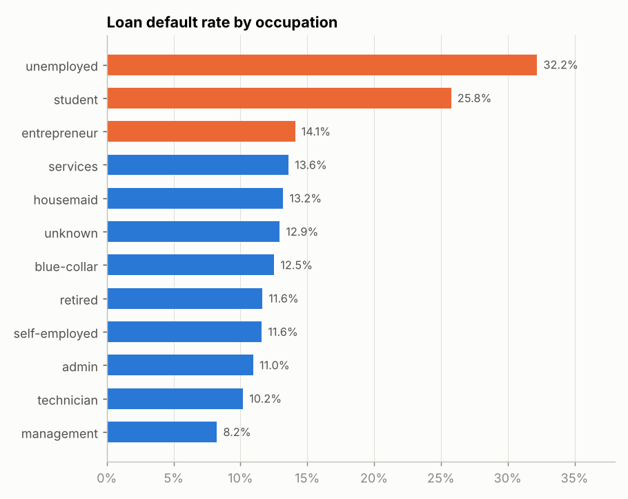
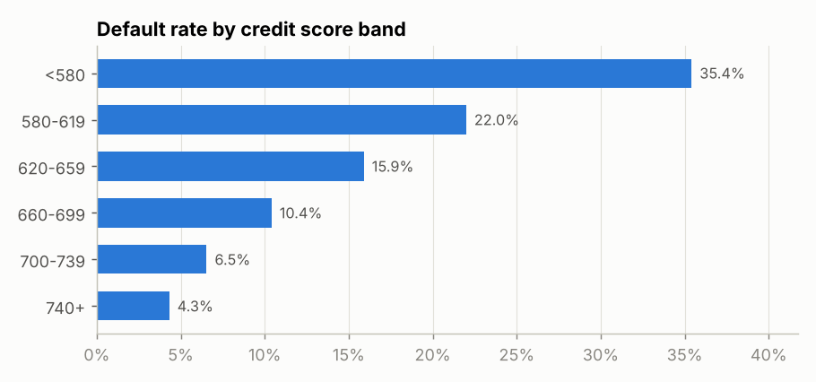
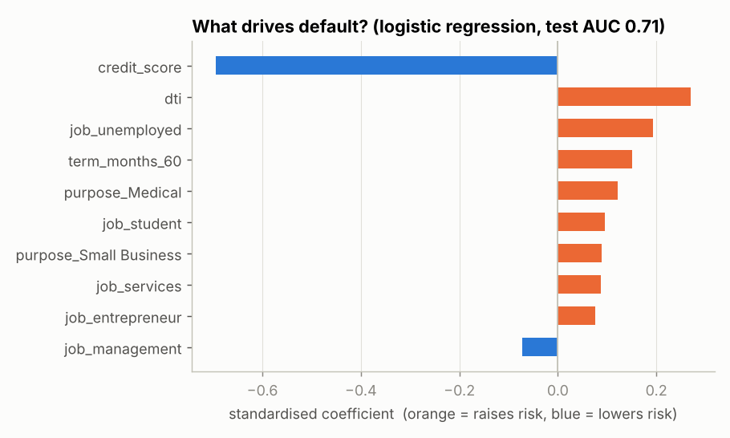
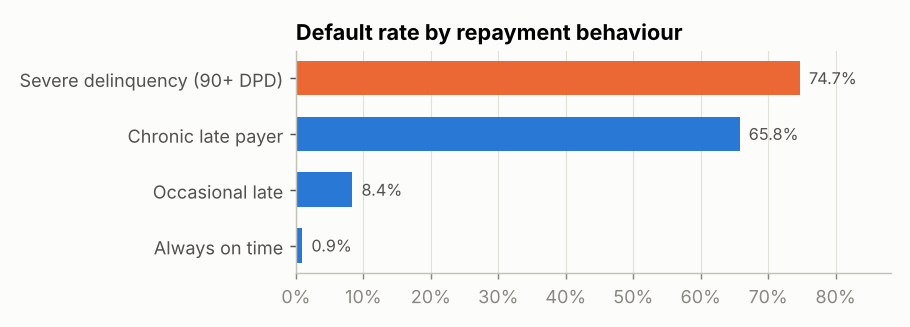
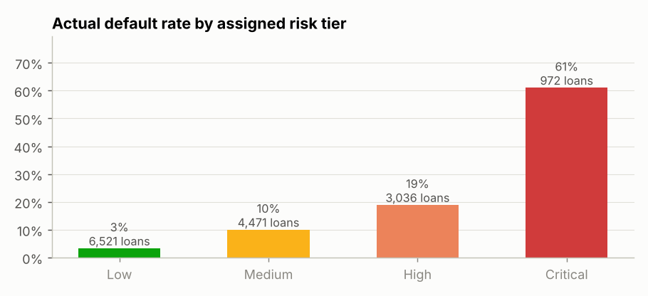
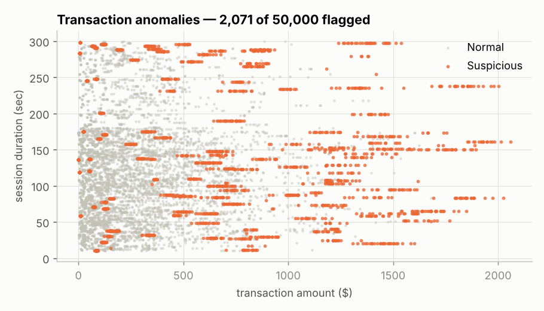
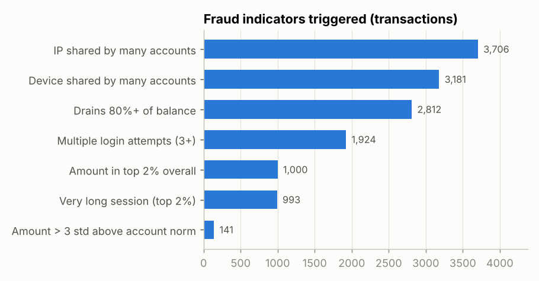
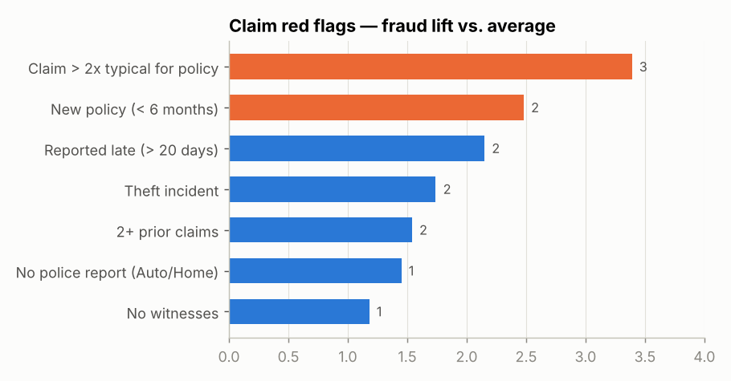
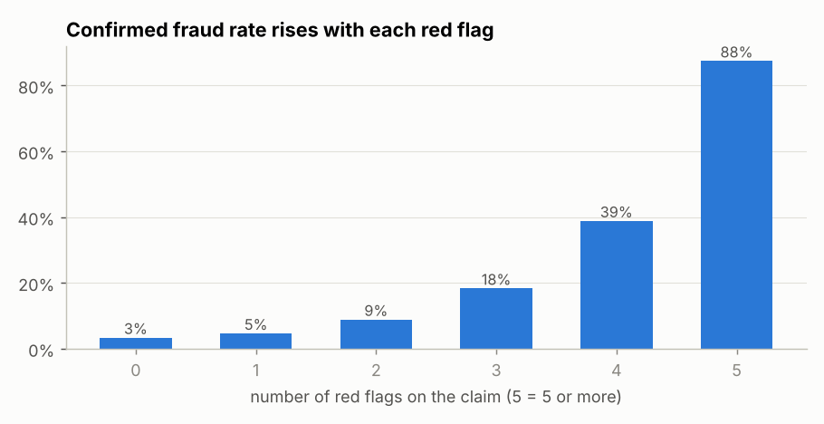

# Financial Risk Report
**Banking & Insurance Risk Analytics** · Prepared by Salma Akter · Data period 2020–2025

> **Data note.** Transactions (50,000) and customers (41,176) are real public datasets. The loan book (15,000 loans) and insurance claims (9,000) are **synthetic**, generated with documented rules and linked to the real customers — the source files contain no loan outcomes or claims. Findings on loans and claims show the *method*; their exact percentages should not be read as real-world facts.

---

## 1. Executive summary

| Area | Headline | Recommended action |
|---|---|---|
| Credit risk | 12.3% of loans defaulted — **$27.5M** of a $228.1M book | Tighten approval for credit score < 620 and DTI > 35% |
| Customer risk | 972 *Critical*-tier borrowers (6.5%) default at **61%**, 18× the Low tier | Early-collections outreach for Critical tier |
| Transactions | **2,071** suspicious transactions (4.1%); 397 high-priority alerts | Step-up authentication on high alerts |
| Insurance | Claims with 4 red flags are fraudulent **39%** of the time vs 3.4% with none | Route claims with 3+ flags (570) to the SIU |

---

## 2. Loan default analysis — *Which customer group defaults most?*

* **Unemployed (32.2%)** and **student (25.8%)** borrowers default at 2.6× and 2.1× the 12.3% average. Management (8.2%) is lowest.
* Riskiest combination: **unemployed, age 26–35 — 32.3%** (SQL Q4).
* Default falls steadily as **credit score** rises: 35.1% below 580 → 4.3% at 740+ (SQL Q2).
* **Debt-to-income** above 35% roughly doubles risk vs DTI under 15% (19.4% vs 7.4%).
* **Medical (16.0%)** and **Small Business (15.9%)** loans default most; Auto loans least (11.1%).

**What drives default?** A logistic-regression probability-of-default (PD) model (test AUC **0.71**) ranks credit score as the strongest protective factor, followed by DTI, unemployment and 60-month terms as risk factors.

---

## 3. Customer risk segmentation — *Which segment is most risky?*

K-Means (k = 4) on credit score, DTI, income, loan size and late payments:

| Segment | Borrowers | Avg credit | Avg DTI | Default rate |
|---|---:|---:|---:|---:|
| Steady Prime | 5,631 | 709 | 19.0% | 3.9% |
| Stretched Mid-Market | 5,215 | 659 | 30.0% | 6.9% |
| Affluent Prime | 2,408 | 691 | 26.8% | 8.0% |
| **Stressed Borrowers** | **1,746** | **651** | 26.5% | **61.5%** |

**Stressed Borrowers** are separated mainly by repeated late payments (2.8 times 30+ days past due vs ≤ 0.5 elsewhere). Affluent Prime earns most but takes the largest loans ($32.7K), so its risk is higher than its income suggests.

In the **real customer base**, 46% of customers with unknown occupation and 34% of blue-collar customers have an *unknown* credit-default status — a data-quality gap that should be closed before lending to them.

---

## 4. Customer payment behaviour

| Repayment history | Borrowers | Default rate |
|---|---:|---:|
| Always on time | 8,289 | 0.9% |
| Occasional late (1–2 × 30 DPD) | 4,832 | 8.4% |
| Chronic late payer (3+ × 30 DPD) | 441 | 65.8% |
| Severe delinquency (90+ DPD) | 1,438 | 74.7% |

Late-payment history is the clearest early-warning signal: the jump from *occasional* to *chronic* late payer is 8× in default rate.

In the **transaction data**, ATM debits are the most common balance-draining transactions (971 debits taking 80%+ of the balance, SQL Q10).

---

## 5. Risk category analysis

Each borrower gets a 0–100 score: **60% model PD + 25% delinquency history + 15% DTI**, then a tier.

| Tier | Borrowers | Exposure | Default rate |
|---|---:|---:|---:|
| Low | 6,521 | $95.8M | 3.4% |
| Medium | 4,471 | $68.8M | 10.1% |
| High | 3,036 | $48.3M | 19.0% |
| **Critical** | **972** | **$15.2M** | **61.1%** |

The tiers rank risk cleanly (each tier defaults about 2–3× more than the one below), so they can drive pricing, limits and collections priority.

---

## 6. Transaction anomaly detection — *Which transactions are abnormal?*

Two methods were combined:
1. **Seven red-flag rules** (below) that an analyst can explain to an auditor.
2. **Isolation Forest**, an unsupervised ML model that scores how unusual each transaction is (2% contamination).

A transaction is *suspicious* if it hits 2+ rules **or** the model flags it → **2,071 transactions (4.1%)**. *High* alerts (3+ rules, or model + 2 rules) = **397**.

* **Branch** transactions have the highest suspicious rate (5.0%) vs Online (3.3%).
* The top alerts cluster on a few accounts (e.g. AC00454: repeated ATM withdrawals of ~$1,200+ after 5 login attempts), which points to targeted account review rather than broad rules.

---

## 7. Fraud indicators

**Transactions** (SQL Q8–Q10):

* 1,924 transactions followed **3+ login attempts**.
* 19 devices are used by **8–9 different accounts** — a classic sign of shared or compromised devices (SQL Q9).
* 141 transactions are **more than 3 standard deviations** above the account's normal amount; 43% of these are also flagged by the Isolation Forest — the best agreement of any rule.

**Insurance claims** — *Which claim patterns are abnormal?*

| Red flag | Fraud lift |
|---|---:|
| Claim > 2× typical for the policy type | 3.39× |
| New policy (< 6 months) | 2.48× |
| Reported late (> 20 days) | 2.15× |
| Theft incident | 1.74× |
| 2+ prior claims | 1.54× |

Fraud rises with every extra flag (3.4% → 4.7% → 8.9% → 18.4% → 38.9%). The **flag count** is a simple, explainable triage score: the 570 claims with 3+ flags (6% of claims) should go to the Special Investigation Unit.

---

## 8. Recommendations

1. **Credit policy:** require income verification or a co-signer for unemployed/student applicants; cap DTI at 35% for scores below 620.
2. **Collections:** contact Critical-tier borrowers after the *first* missed payment — the step from occasional to chronic late payer is where risk explodes.
3. **Fraud operations:** add step-up authentication (OTP) after 3 failed logins, and review devices shared by 8+ accounts.
4. **Claims:** auto-route claims with 3+ red flags to investigation; fast-track 0-flag claims to cut handling cost.
5. **Data quality:** resolve the *unknown* credit status for 21% of the customer base.

## 9. Limitations

* Loans and claims are synthetic — patterns reflect the generation rules (documented in `docs/DATA_DICTIONARY.md`).
* The transaction file is an augmented dataset: customer age/occupation are not consistent within an account, so they were not used for account-level conclusions, and there is no fraud label — anomaly flags are *leads to investigate*, not confirmed fraud.
* The customer and transaction datasets come from different sources and cannot be joined.
